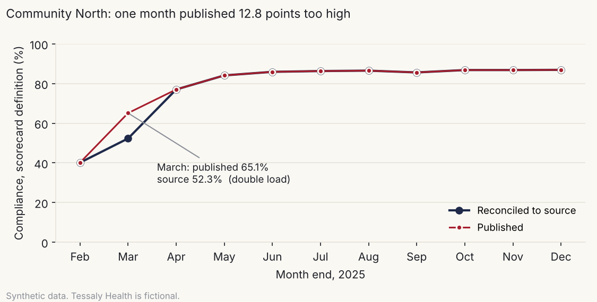

# Governed reporting

**Case study D · Lineage, reconciliation and access control for a recurring executive report**

*Tessaly Health is a fictional nonprofit health system. Every number on this page comes from synthetic data and shows a method, not a real result.*

---

## 1. The question

Tessaly Health's executive team gets a compliance scorecard every month. Case study A fixed *what* the scorecard should measure. This one asks whether the monthly numbers actually match the source data, who can see what, and which controls would catch a bad month before it reaches executives.

## 2. The data

All from the Tessaly Health synthetic data generator (LIB-23, `generator/`, seed 20261108), covering 2023–2025:

| Table | Rows |
|---|---:|
| Published scorecard values (facility-month) | 208 across 35 months |
| Enrollments behind them | 93,846 |
| Nightly HR feed runs | 1,096 |
| Report lineage steps for the scorecard | 5 |
| BI users / access roles | 186 / 5 |
| Report catalog | 22 reports |

The generator plants pipeline defects in three published months and three access problems, and records them in an answer key I opened only after the analysis.

**Limits.** The report catalog, its view counts and the access roles are invented and small. The pipeline defects are three plausible kinds, not a full catalog of what goes wrong. Reconciliation here uses the scorecard's *own* definition, so it tests the pipeline, not the definition. Case study A covers the definition.

## 3. Approach

1. **Trace the lineage.** The scorecard's five steps run from HR system to BI tool. Three have controls, and all three check that rows moved, not that the number is right. The two steps that turn rows into a compliance rate have none.
2. **Reconcile every published number to source.** Rebuild each of the 208 facility-months from raw data using the scorecard's documented definition, and compare.
3. **Diagnose by testing explanations.** For each mismatch, test specific hypotheses against the source: stale data (does it match as of an earlier date?), wrong population (does it match if agency accounts are included?), double load (is the excess exactly that month's completions?). A diagnosis counts only if it reproduces the published number exactly.
4. **Backtest controls.** Run five candidate controls across all 35 months to see which would have caught each defect, and how many false alarms each would have raised.
5. **Review access and the report estate.** Audit BI access against a role model (LIB-07), and apply keep, merge or retire criteria to the 22 reports (LIB-51).

**Alternatives I considered.** A trend alarm (flag any month that moves more than 3 points) is the usual cheap control, so I tested it rather than assumed it. Rebuilding the pipeline was the other option. Reconciling to source answers the question without rebuilding anything.

## 4. Validation

| Check | Result |
|---|---|
| Every mismatch reproduced exactly by a tested explanation | 7 of 7 facility-months. Pass |
| Mismatched months vs. the answer key | Exactly the 3 planted months, no others. Pass |
| Each diagnosis vs. the planted cause | Stale data (4 days), double load, agency population: all correct. Pass |
| Access review vs. the answer key | Exactly the 3 planted problems (4 accounts), nothing else. Pass |
| Mockup numbers vs. case study A's governed results | Identical. Pass |

The answer key lists 6 rows for the stale month; 5 differed. The sixth facility had no activity in the stale window, so its numbers came out the same.

## 5. Findings (synthetic data)

**Three of 35 months were published wrong, and nobody would have seen two of them.**

| Month | Facility | Published | Source | Cause |
|---|---|---:|---:|---|
| Aug 2024 | 5 of 6 facilities | e.g. 84.8% | 84.7% | Built from data 4 days old after a 3-night HR feed outage |
| Mar 2025 | Community North | 65.1% | 52.3% | Completions loaded twice: 301 extra |
| Oct 2025 | Flagship Hospital | 86.6% | 86.4% | Agency accounts included (174 extra rows) |



The March error was large, 12.8 points, and it happened mid-campaign, when the number is supposed to move fast. The other two moved the rate by less than half a point, which is exactly why they're dangerous: nothing about them looks wrong.

**The usual alarm caught nothing.** I backtested five controls over all 35 months:

| Control | Caught | Missed | False alarms |
|---|---|---|---:|
| K1 Feed freshness (no failed run in the last 3 days of the month) | Aug 2024 | Mar, Oct 2025 | 0 |
| K2 Full reconciliation to source | All three | none | 0 |
| K3 Month's numerator increase ≤ completions recorded that month | Mar, Oct 2025 | Aug 2024 | 1 |
| K4 Denominator ≤ staff-only assignments | Oct 2025 | Aug 2024, Mar 2025 | 0 |
| K5 Rate moves more than 3 points (outside the campaign) | none | all three | 1 |

Full reconciliation is the only single control that catches everything. Freshness, numerator and population checks are each cheaper, and together they cover all three. The trend alarm, the control most teams already have, missed all three and raised a false alarm. K3's one "false alarm" is September 2024, the month after the stale load, when four days of August completions arrived at once. It's the stale month echoing, not noise.

**Access had outlived jobs.** Of 138 active BI users, two managers who had left still had person-level access to their old units. One unit manager had system-wide scope, and one aggregate-only analyst had person-level detail. Five people could see named records for the whole system; the role model allows three. Details are in [`access_model.md`](access_model.md) (LIB-07).

**Half the reports could go.** 22 reports become 11 plus 1 under review: five duplicates or unused reports retire, and five merge into the reports that absorb them. Two of the retirements are duplicate copies of compliance reports, the same kind of second number that started case study A. Details are in [`report_rationalization.md`](report_rationalization.md) (LIB-51).

## 6. What I'd do in practice

- **Gate publication on three cheap checks plus a monthly reconciliation:** feed freshness, numerator vs. completions, and staff-only population. Reconciliation runs before the executive version is released, not after.
- **Put controls where meaning is created.** Add the data-quality checks before the fact table and the reconciliation before the scorecard (see [`architecture.md`](architecture.md), LIB-46).
- **Drop the trend alarm as the main control.** Keep it, if at all, as a prompt to look, not as assurance.
- **Correct and annotate the three months.** Republish with a note that says what changed and why.
- **Wire access to HR events.** Leavers lose access within 2 business days, movers' scope follows their unit, and a quarterly review catches the rest.
- **Retire and merge the reports in one release**, with a 30-day window for owners to object.
- **Publish the governed weekly view** (mockup in [`dashboard_mockup.md`](dashboard_mockup.md), LIB-03), with definition, date, freshness and check status in its header.

## 7. Files

| File | What it is |
|---|---|
| [`access_model.md`](access_model.md) | LIB-07 role-based access model and review |
| [`report_rationalization.md`](report_rationalization.md) | LIB-51 keep, merge, retire worksheet |
| [`architecture.md`](architecture.md) | LIB-46 data path with control points |
| [`dashboard_mockup.md`](dashboard_mockup.md) | LIB-03 governed weekly view |
| `analysis/reconcile.py` | Reconciliation, diagnosis and control backtest |
| `analysis/access_review.py` | Access review against the role model |
| `analysis/rationalize.py` | Report rationalization |
| `analysis/visuals.py` | Chart, architecture diagram and mockup |
| `analysis/validate_d.py` | Comparison with the answer key and with case study A |
| `outputs/` | Result tables, figures, validation report |

To reproduce (after case study A):

```
cd case-studies/d-governed-reporting/analysis
python reconcile.py && python access_review.py && python rationalize.py && python visuals.py && python validate_d.py
```

*All code is AI-assisted (Claude). I designed the reconciliation, the hypotheses, the controls, the access model and the criteria; Claude wrote the code to that design; the validation above is how I checked it.*

---
*Personal project. All data is synthetic or public, and the company is fictional. Views are my own and not affiliated with or endorsed by any current or former employer.*
